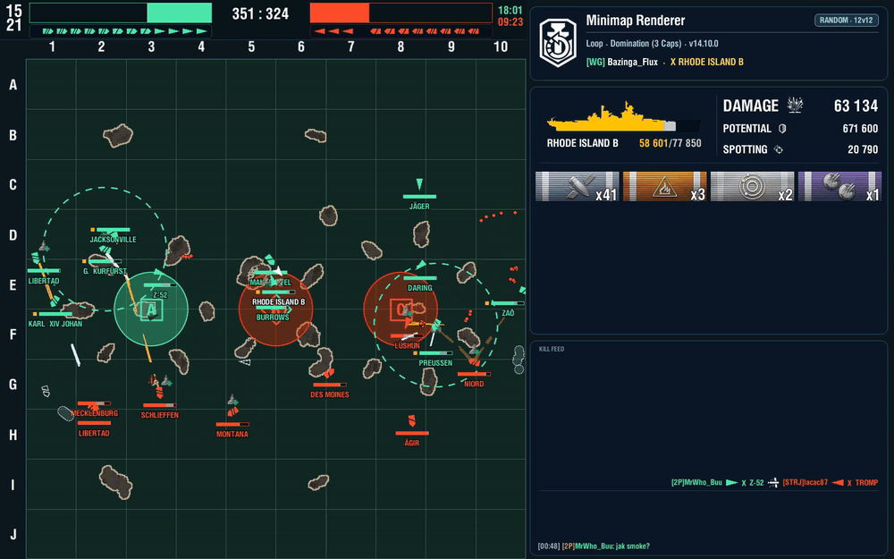
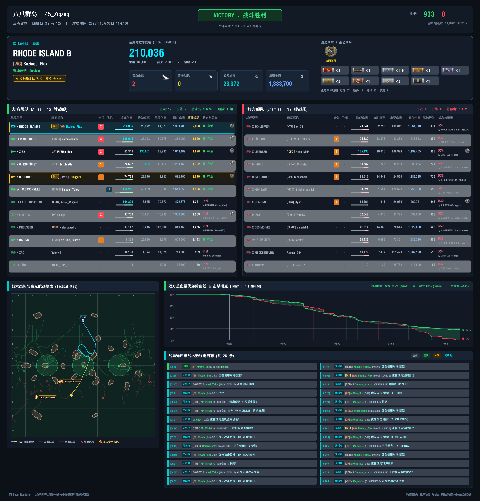

<div align="center">

# Minimap Renderer

**将《战舰世界》回放转化为 1920×1200 原生 60 FPS 小地图战术视频与 2.4K 超高清全景复盘战报**

[English](README_EN.md) · [问题反馈](https://github.com/In-dor/minimap_renderer/issues) · [原始项目](https://github.com/WoWs-Builder-Team/minimap_renderer)

[](https://github.com/In-dor/minimap_renderer/actions/workflows/tests.yml)
[](https://www.python.org/)
[](https://github.com/In-dor/minimap_renderer)
[](LICENSE)
[](https://github.com/In-dor/minimap_renderer)



</div>

> [!IMPORTANT]
> 原仓库 [WoWs-Builder-Team/minimap_renderer](https://github.com/WoWs-Builder-Team/minimap_renderer) 已归档停更。当前持续维护、适配最新客户端版本并包含新版战术 HUD 与 2.4K 战报引擎的分支为 **[In-dor/minimap_renderer](https://github.com/In-dor/minimap_renderer)**，请在本仓库安装、更新与提交反馈。

`Minimap Renderer` 是一款面向《战舰世界》（World of Warships）`.wowsreplay` 回放文件的战术可视化与战局复盘工具。只需一次解析，即可同步输出 **流畅无重影的 60 FPS 小地图延时视频**、**对齐官方结算真值的 2.4K 全景复盘战报长图** 以及 **友方舰船配装导出文件**，同时支持赛事级双阵营上帝视角合流渲染。

---

## 核心特性

### 1. 小地图战术视频与现代化 HUD（`*.mp4`）

- **原生 `1920×1200`（`8:5`）矢量级高清绘制**：直接在目标分辨率画布上按比例缩放海图、字体与图标，摒弃低清画布后期拉伸，文字边缘与舰种轮廓清晰锐利。
- **原生状态时间插值（`native` 60 FPS）**：在渲染器内部对舰船位置、航向角、舰载机、炮弹与鱼雷生成连续中间状态，彻底消除传统帧混合带来的拖影与重影。
- **现代化深海战术 HUD 布局**：
  - **顶栏全局态势条**：集成双方实时比分进度条、胜负预测倒计时、居中战斗时钟，以及**双方存活/阵亡舰种剪影阵容对比条**。
  - **右侧三段式半透明战术卡片**：
    - **对局元信息卡**：显示地图名称、对局与占领模式徽章、客户端版本号，以及录制者 `[军团]` 昵称与等级舰名。
    - **舰体状态与战果卡**：配备暗底槽与灰白可回复血段（维修小组）的动态变色血条、起火/进水部位图标、实时造成伤害 / 潜在承伤 / 协助点亮计数，以及自动排布的战功丝带与成就勋章。
    - **战况流与通讯卡**：上方滚动展示带击杀手段图标的实时击杀播报（Kill Feed），下方呈现带 `[MM:SS]` 战斗时间戳、军团原色标签与分队金色高亮的局内聊天流。
- **高辨识度战场图层**：
  - **精确 `10×10` 战术网格**与海图边框对齐；
  - **水平防重叠舰名标签**：带深色描边衬底、自动碰撞避让与底部边界自动正向翻转（告别倒置舰名），实时叠加集火标记、雷达/水听激活图标与作用范围圈；
  - **柔雾底 + 合并外轮廓虚线环烟幕**：采用 2× 超采样抗锯齿绘制，自动擦除烟团内部重叠弧线，仅保留干净的外围虚线边界；
  - **高区分度弹道与鱼雷**：主副炮分层透明度，冷青白 `AP`（`#c8f4ff`）、琥珀橙 `HE` 与亮洋红 `SAP`（`#ff5cc8`）一目了然；常规鱼雷带深色衬底外圈，潜艇声导鱼雷额外附带亮青色声导外环（`#9ef6ff`）。
- **多语种零乱码确定性选字**：基于确定性 Unicode 码位区间自动路由中 / 日 / 韩 / 西里尔 / 拉丁扩展字体，彻底解决多国服玩家同场时的方块字与乱码问题。
- **高性能异步编码流水线**：结合 LIFO 帧缓冲内存池复用、区间静态底图缓存、LRU 图标旋转缓存与后台异步 FFmpeg 硬件编码线程，大幅压缩整场渲染耗时。

### 2. 2.4K 超高清战后复盘全景战报（`*-report.png`）

<div align="center">
  
</div>

- **单次解析零额外开销**：同时渲染视频与战报时直接复用内存解析结果，单次数据包流遍历即可同步提取 `Packet 0x22`（`playersPublicInfo`）官方结算真值与 `Avatar.receive_CommonCMD` 无线电指令，视频编码结束后约 **1 秒**即可生成战报；亦支持 `--report-only` 跳过视频、秒级独立出图。
- **个人高光 Hero 面板**：展示舰船等级/舰种/系别、存活状态或击沉者、金色组队分队徽章、**按武器大类智能聚合的伤害明细**（主炮 / 副炮 / 鱼雷 / 声导雷 / 起火 / 进水 / 火箭弹 / 航弹 / 深弹 / 水雷 / 导弹 / 撞击）、击沉/防空击落/协助点亮/潜在承伤四维统计卡，以及自适应成就勋章栏、全量战功丝带网格与主炮命中明细（过穿/跳弹/碎弹/贯穿）。
- **全模式自适应双阵营记分板**：动态适配对决、排位（6v6 / 7v7）、军团战、随机战（12v12）乃至行动模式（70+ 波次增援 AI 舰船自动伸缩并双侧等高对齐）；完整呈现**着色官方舰种剪影图标**、组队徽章与专属高亮、**全场最高伤害归一化渐变占比条（Data Bar）**、造成伤害、**协助点亮**、承受伤害、潜在伤害、基础经验（胜方含 1.5× 加成标注 `*`）与当局勋章角标；全字段支持像素级省略截断，杜绝长昵称溢出重叠。
- **内嵌 `760×760` 静态战术航迹小地图**：融合高清海图、终局占领区归属圈、全队推进幽灵线（敌舰灭点或跨度跳变时自动断段防止穿山连线）、录制者时间渐变高光航迹（冰蓝 → 亮青 → 金黄，标注 `START` 起点与终局锚点）以及防碰撞 `[MM:SS] 舰名` 击沉标记（本人亲手击沉专属高亮）。
- **双方总血量优劣势曲线 & 自适应双栏通讯面板**：右上方绘制全队实时总血量百分比差值包络线与击杀拐点；右下方按时间交错呈现全局/团队/分队文字聊天与原生解码的**战术无线电快捷指令**（注意扇区坐标、优先集火目标、请求支援、占领/防守点位、监视雷达/对海搜索/潜艇监视设备播报等），支持双行自动折行。

### 3. 配装导出与赛事双视角合流

- **玩家配装自动导出（`*-builds.json`）**：渲染视频时自动提取友方玩家舰船配件、消耗品与舰长技能，生成可直接跳转查看的 [WoWs ShipBuilder](https://app.wowssb.com/) 配装链接。
- **双阵营上帝视角合流（`RenderDual`）**：支持将同一场战斗红绿双方的两份回放合流渲染为无战争迷雾的赛事复盘视频。

---

## 快速安装

### 环境要求

- Python `3.10` 或更高版本（推荐 `3.10`）
- Windows 或 Linux
- 有效的《战舰世界》`.wowsreplay` 回放文件

项目通过 `imageio-ffmpeg` 内置提供 FFmpeg 视频编码可执行文件，常规安装后开箱即用，无需手动配置系统 `PATH`。

### Windows

```bat
py -3.10 -m venv .venv
.venv\Scripts\activate
python -m pip install --upgrade pip
pip install --upgrade --force-reinstall git+https://github.com/In-dor/minimap_renderer.git
```

### Linux

```bash
python3.10 -m venv .venv
source .venv/bin/activate
python -m pip install --upgrade pip
pip install --upgrade --force-reinstall git+https://github.com/In-dor/minimap_renderer.git
```

---

## 快速上手

使用默认推荐配置渲染一场回放（同时输出视频、配装 JSON 与 2.4K 战报）：

```bash
python -m render --replay "path/to/battle.wowsreplay"
```

Windows 示例：

```bat
python -m render --replay "F:\Replays\20260713_165525_PRSB510-Slava_54_Faroe.wowsreplay"
```

默认参数为 `1920x1200` 分辨率、`60 FPS`、`15x` 播放倍速、画质 `8`、`native` 原生插值与 `auto` 硬件加速编码。输出文件保存在回放同级目录下：

```text
battle.mp4            # 1920x1200 60 FPS 小地图战术延时视频
battle-builds.json    # 友方玩家 WoWs ShipBuilder 配装链接
battle-report.png     # 2.4K 超高清战后复盘全景战报长图
```

### 仅生成 2.4K 战报长图（秒级出图）

如果只需快速复盘战绩或生成战报图片分享，无需等待视频逐帧编码，可使用 `--report-only`：

```bash
python -m render --replay "battle.wowsreplay" --report-only
```

在源码仓库目录下，也可以直接运行独立工具脚本（支持 `-o` 指定输出路径）：

```bash
python tools/generate_battle_report.py "battle.wowsreplay" -o "custom_report.png"
```

---

## 命令行参数详解

```text
python -m render --replay REPLAY
                 [--fps FPS]
                 [--speed SPEED]
                 [--resolution WIDTHxHEIGHT]
                 [--quality 1-10]
                 [--interpolation {native,blend,motion,duplicate}]
                 [--codec {h264,h265,av1}]
                 [--encoder {auto,cpu,nvenc,qsv,vaapi,amf}]
                 [--no-report]
                 [--report-only]
                 [--report-path REPORT_PATH]
```

| 参数              |      默认值 | 说明                                                                                                 |
| ----------------- | ----------: | ---------------------------------------------------------------------------------------------------- |
| `--replay`        |        必填 | `.wowsreplay` 回放文件路径                                                                           |
| `--fps`           |        `60` | 输出视频帧率（必须大于 `0`；`native` 模式下需满足 `--fps >= --speed`）                               |
| `--speed`         |        `15` | 延时播放倍速（例如 `15` 代表约 15 倍速浓缩整场战斗）                                                 |
| `--resolution`    | `1920x1200` | 原生渲染分辨率，宽高须为正偶数且保持 `1360:850`（即 `8:5`）画布比例                                  |
| `--quality`       |         `8` | 编码质量（`1-10`）；针对扁平战术 UI 校准量化曲线，`8` 对应约 CRF/CQ `20`，兼顾锐利文字与合理体积     |
| `--interpolation` |    `native` | 帧插值模式：`native`（推荐）、`blend`、`motion`、`duplicate`                                         |
| `--codec`         |      `h264` | 视频编码格式：`h264`（兼容性最佳）、`h265`（高压缩率）或 `av1`                                       |
| `--encoder`       |      `auto` | 硬件/软件编码后端：`auto` 自动实测可用硬件编码器并回退 CPU，也可显式指定 `cpu`/`nvenc`/`qsv`/`vaapi`/`amf` |
| `--no-report`     |     `False` | 渲染视频后跳过自动生成 2.4K 战报长图                                                                 |
| `--report-only`   |     `False` | 仅生成 2.4K 战报长图，跳过小地图视频与配装 JSON 导出                                                 |
| `--report-path`   |      `None` | 自定义战报长图保存路径（默认输出到回放同目录 `<回放文件名>-report.png`）                             |

### 常用预设示例

兼顾高画质、丝滑运动与硬件加速（默认推荐）：

```bash
python -m render --replay "battle.wowsreplay" \
  --fps 60 \
  --speed 15 \
  --resolution 1920x1200 \
  --quality 8 \
  --interpolation native \
  --codec h264 \
  --encoder auto
```

追求更小文件体积与更快出片速度：

```bash
python -m render --replay "battle.wowsreplay" \
  --fps 30 \
  --speed 15 \
  --resolution 1360x850 \
  --quality 7 \
  --interpolation native \
  --codec h265 \
  --encoder auto
```

---

## 视频编码器与插值模式

### 视频编码器（`--codec` 与 `--encoder`）

`--codec` 决定视频编码标准，`--encoder` 决定调用的硬件后端或 CPU 编码器。在默认的 `--encoder auto` 模式下，程序会向 FFmpeg 发送一帧真实测试画面，按 **NVIDIA NVENC → Intel Quick Sync (QSV) → Linux VAAPI → AMD AMF** 的顺序实测硬件初始化能力，而非仅检查编码器列表；若当前环境无可用 GPU 驱动，则自动回退至对应的 CPU 编码器并在日志中打印最终选择。

| 编码格式 | NVIDIA (`nvenc`) | Intel (`qsv`) | Linux (`vaapi`) | AMD (`amf`) | CPU 回退 (`cpu`) | 特点与适用场景                                   |
| -------- | ---------------- | ------------- | --------------- | ----------- | ---------------- | ------------------------------------------------ |
| `h264`   | `h264_nvenc`     | `h264_qsv`    | `h264_vaapi`    | `h264_amf`  | `libx264`        | 浏览器、社交平台与播放器兼容性最好，**默认推荐** |
| `h265`   | `hevc_nvenc`     | `hevc_qsv`    | `hevc_vaapi`    | `hevc_amf`  | `libx265`        | 同等画质下体积更小（带 `hvc1` 标签）             |
| `av1`    | `av1_nvenc`      | `av1_qsv`     | `av1_vaapi`     | `av1_amf`   | `libaom-av1`     | 压缩率最高；CPU 编码较慢，适合新一代显卡硬件编码 |

> [!TIP]
> **Docker / LXC / Linux NAS 硬件加速提示**：
> - 显式指定 `--encoder qsv` 或 `--encoder vaapi` 时，若硬件初始化失败会直接报错而不会静默切换设备；Intel Linux NAS 环境建议保持 `--encoder auto`（QSV 不可用时会自动尝试 VAAPI，最后回退 CPU）。
> - 容器环境使用 VAAPI 需挂载 `/dev/dri/renderD128`、为进程赋予 `render` 组权限并安装对应的媒体驱动。可通过环境变量 `VAAPI_DEVICE` 自定义设备路径（默认 `/dev/dri/renderD128`）。
> - 若 `imageio-ffmpeg` 自带的二进制未编译 VAAPI 支持，可设置环境变量 `IMAGEIO_FFMPEG_EXE=/usr/bin/ffmpeg` 指向系统安装的 FFmpeg。

### 帧插值模式（`--interpolation`）

| 模式        | 工作原理                                                         | 推荐用途       |
| ----------- | ---------------------------------------------------------------- | -------------- |
| `native`    | 在渲染引擎内对舰船坐标、航向、飞机、炮弹与鱼雷做物理状态时间插值 | **默认推荐**   |
| `blend`     | 通过 FFmpeg `framerate` 滤镜混合相邻源帧；速度快但移动目标有重影 | 兼容旧版风格   |
| `duplicate` | 直接复制源帧匹配目标帧率；开销最低，但高速倍速下运动不够连贯     | 极限追求速度   |
| `motion`    | 调用 FFmpeg `minterpolate` 双向运动补偿；CPU 开销极大且易生伪影  | 仅限实验性测试 |

---

## 双阵营上帝视角合流（`RenderDual`）

针对军团战、锦标赛或训练房复盘，如果同时拥有同一场对局（相同 `game_arena_id` 与客户端版本）双方阵营各一名玩家的回放文件，可通过 `RenderDual` 合流渲染同时展现双方真实视野、弹道与鱼雷的全局复盘视频（参考仓库根目录 [`render_dual.py`](render_dual.py)）：

```python
from replay_parser import ReplayParser
from renderer.render import RenderDual

with open("team_alpha.wowsreplay", "rb") as f1, open("team_bravo.wowsreplay", "rb") as f2:
    alpha_data = ReplayParser(f1, strict=True).get_info()["hidden"]["replay_data"]
    bravo_data = ReplayParser(f2, strict=True).get_info()["hidden"]["replay_data"]

    RenderDual(
        alpha_data,
        bravo_data,
        green_tag="Alpha",
        red_tag="Bravo",
    ).start(
        "minimap_dual.mp4",
        fps=30,
        speed=15,
        resolution=(1920, 1200),
        interpolation="blend",
    )
```

> 注：`RenderDual` 需对齐双端整数事件时间轴，不支持 `native` 插值模式，建议使用 `blend` 或 `duplicate`。

---

## 版本兼容性与问题反馈

- **支持最新版本**：当前已持续跟进并完整支持至《战舰世界》**`15.10.0`** 版本。
- **广泛历史回放兼容**：内置覆盖 **`0.11.6` ~ `15.10.0`** 的多版本解析定义与 40+ 个高分缩放适配图层，并兼容随机战、排位战、军团战、对决、联合人机、飞艇护航、军备竞赛及行动模式（Operations）等特殊对局与专属消耗品。对于缺少 `Packet 0x22` 结算包的早期历史回放（如 `0.11.x` ~ `12.5`）或中途退出的未完结回放，战报生成器会自动启用流式伤害与击杀补偿推算布局。
- 由于新游戏版本更新可能调整底层网络实体协议，尚未适配的未来版本回放可能无法立即解析。

如遇解析报错或显示异常，欢迎提交 [Issue](https://github.com/In-dor/minimap_renderer/issues) 并附上：
1. 游戏客户端版本号与服务器区域（如亚服 / 欧服 / 美服 / 国服）
2. 实际执行的命令行参数与完整错误堆栈日志
3. 可用于复现问题的 `.wowsreplay` 回放文件（如方便提供）

---

## 源码开发与测试

克隆仓库并在虚拟环境中以可编辑模式安装开发测试依赖（注意仓库根目录源码位于 `src/` 下）：

```bash
git clone https://github.com/In-dor/minimap_renderer.git
cd minimap_renderer
python3.10 -m venv .venv
```

Windows：

```bat
.venv\Scripts\activate
pip install -e ".[testing]"
pytest
```

Linux：

```bash
source .venv/bin/activate
pip install -e ".[testing]"
pytest
```

---

## 项目沿革与致谢

本仓库复刻并演进自已归档的 [WoWs-Builder-Team/minimap_renderer](https://github.com/WoWs-Builder-Team/minimap_renderer)，在此基础上持续跟进新版客户端协议适配，重构了原生高分辨率时间插值流水线、深海战术 HUD 界面以及 2.4K 全景复盘战报系统。

衷心感谢原项目维护者 `notyourfather`、`Trackpad` 及历代社区贡献者，同时感谢 Monstrofil 开发的 [replays_unpack](https://github.com/Monstrofil/replays_unpack) 为回放数据包解包奠定的坚实基础。

## 许可证

本项目基于 [GNU Affero General Public License v3.0 (AGPL-3.0)](LICENSE) 开源发布。
