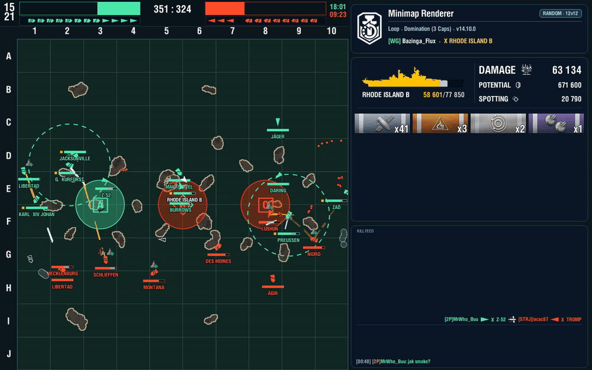
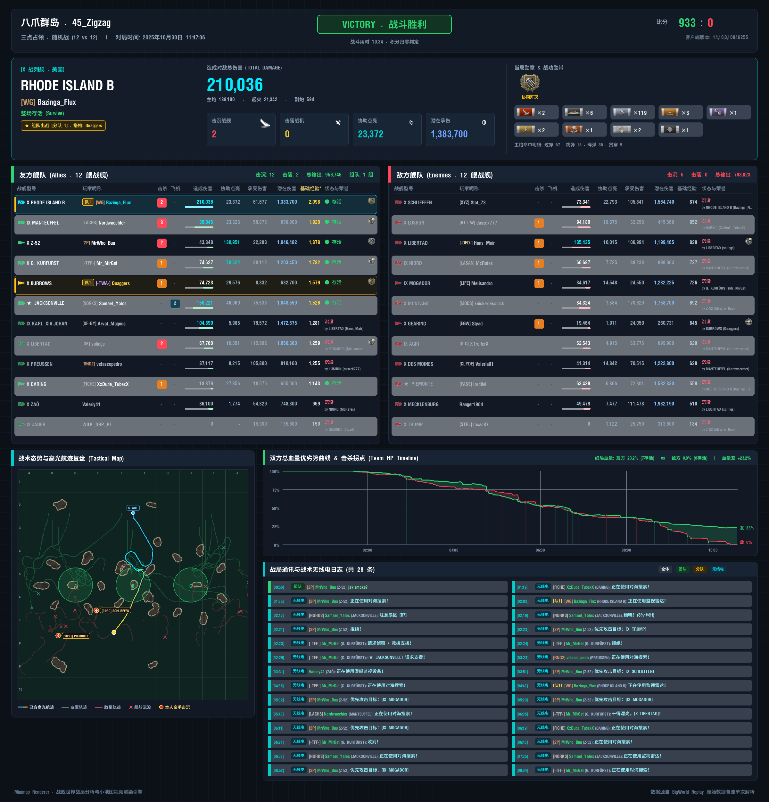

<div align="center">

# Minimap Renderer

**Turn World of Warships replays into native 1920×1200 60 FPS tactical minimap videos and 2.4K post-battle review infographics**

[简体中文](README.md) · [Report an Issue](https://github.com/In-dor/minimap_renderer/issues) · [Original Project](https://github.com/WoWs-Builder-Team/minimap_renderer)

[](https://github.com/In-dor/minimap_renderer/actions/workflows/tests.yml)
[](https://www.python.org/)
[](https://github.com/In-dor/minimap_renderer)
[](LICENSE)
[](https://github.com/In-dor/minimap_renderer)



</div>

> [!IMPORTANT]
> The upstream [WoWs-Builder-Team/minimap_renderer](https://github.com/WoWs-Builder-Team/minimap_renderer) repository has been archived and is no longer maintained. **[In-dor/minimap_renderer](https://github.com/In-dor/minimap_renderer)** is the actively maintained fork with up-to-date client support, the redesigned tactical HUD, and the 2.4K post-battle report generator. Please install updates and report issues here.

`Minimap Renderer` is a tactical visualization and post-battle analysis toolkit for *World of Warships* `.wowsreplay` files. From a single replay pass, it produces a **crisp, ghost-free 60 FPS minimap timelapse video**, a **2.4K post-battle tactical review infographic** backed by official server settlement data, and **ShipBuilder loadout links**, with built-in support for dual-perspective tournament renders.

---

## Key Features

### 1. Tactical Minimap Video & Modernized HUD (`*.mp4`)

- **Native `1920×1200` (`8:5`) High-DPI Rendering**: Draws maps, typography, and vector-sharp icons directly onto the target canvas instead of upscaling a low-resolution frame afterward.
- **Native State Interpolation (`native` 60 FPS)**: Computes continuous intermediate positions and headings for ships, squadrons, artillery shells, and torpedoes inside the renderer—eliminating frame-blending ghosting.
- **Modern Deep-Sea Tactical HUD**:
  - **Top Situation Bar**: Displays live team score bars, predicted win countdowns, a centered match timer, and an **alive/sunk ship-class silhouette lineup bar** for both teams.
  - **Three-Stage Translucent Tactical Sidebar**:
    - **Match Metadata Card**: Shows map name, battle/mode badge, client version, and the recorder's `[CLAN]` nickname, tier, and ship name.
    - **Ship Status & Combat Card**: Renders a color-graded HP bar with a dark trough and gray repairable-HP segment, active fire/flooding hull nodes, live damage / potential / spotting counters, and wrapping ribbons & achievement medals.
    - **Kill Feed & Match Chat Card**: Combines a weapon-icon kill feed on top with a `[MM:SS]` timestamped chat log featuring clan tag colors and gold division-chat highlighting below.
- **High-Clarity Battlefield Layers**:
  - **Exact `10×10` Tactical Grid** and crisp minimap frame borders;
  - **Horizontal Outlined Ship Labels**: Dark-stroked horizontal ship names with automatic overlap avoidance and bottom-edge upright flipping (no upside-down ship names), paired with focus-fire markers and active radar/hydro indicator rings;
  - **Soft-Fog Merged Dashed Smoke**: Rendered with 2× supersampled anti-aliasing that erases overlapping interior arcs so smoke screens display a clean, unified outer dashed perimeter;
  - **Distinct Munitions & Torpedoes**: High-contrast ice cyan-white `AP` (`#c8f4ff`), amber-orange `HE`, and bright magenta `SAP` (`#ff5cc8`) tracers with main/secondary opacity separation; dark-outlined torpedoes plus bright cyan homing rings (`#9ef6ff`) for submarine acoustic torpedoes.
- **Deterministic Multilingual Font Routing**: Automatically selects Chinese, Japanese, Korean, Cyrillic, or Latin fonts via deterministic Unicode code-point ranges—eliminating garbled glyphs (`□`) in multi-region matches without non-deterministic language guessing.
- **High-Throughput Async Pipeline**: Combines LIFO frame-buffer pooling, static interval base-frame caching, LRU rotated-icon caches, and background FFmpeg hardware encoding.

### 2. 2.4K Post-Battle Review Infographic (`*-report.png`)

<div align="center">
  
</div>

- **Zero-Overhead Single-Pass Extraction**: Reuses the parsed replay in memory when rendered alongside a video, capturing official `Packet 0x22` (`playersPublicInfo`) settlement results and `Avatar.receive_CommonCMD` binary radio commands in one stream pass to output the 2.4K report in **~1 second** after video encoding—or standalone in ~1 second via `--report-only`. Gracefully falls back to stream-reconstructed stats on legacy or incomplete replays lacking `Packet 0x22`.
- **Personal Spotlight Hero Card**: Displays ship tier/class/nation, survival or killer attribution, gold division squad badges, **smart weapon-category damage breakdown** (main battery, secondaries, torpedoes, acoustic torpedoes, fire, flooding, rockets, bombs, depth charges, mines, missiles, ramming), 4-way combat cards (ships sunk, aircraft shot down, spotting damage, potential damage), adaptive single/double-row achievement medals, full ribbon grid, and main-battery shell hit details.
- **Mode-Adaptive Dual Team Scoreboards**: Dynamically scales across Brawls, Ranked (6v6 / 7v7), Clan Battles, Random Battles (12v12), and Operations (70+ wave-spawned AI ships with equalized panel heights). Features **tinted official ship-class silhouettes**, division badges & row highlights, **match-normalized damage Data Bars**, true damage dealt, **spotting damage**, damage taken, potential damage, Base XP (marked with `*` on the winning team for the 1.5× victory bonus), survival/killer info, and per-player medal icons—all protected by pixel-exact binary-search ellipsis truncation.
- **Embedded `760×760` Tactical Track Minimap**: Overlays the map, final capture zone ownership, team movement ghost trails (automatically segmented across unspotted gaps to prevent island-crossing artifacts), the recorder's **time-gradient highlight trajectory** (ice-blue → cyan → gold, with `START` and end/sunk anchors), and collision-avoided `[MM:SS] SHIP` sunk markers.
- **Team HP Advantage Curve & Adaptive Dual-Column Comms Log**: Plots real-time team HP percentage curves with shaded advantage envelopes and kill inflection ticks on top, paired below with a chronological log interleaving All / Team / Division text chat and natively decoded **tactical quick radio commands** (sector pings, focus-target calls, support requests, cap/defend orders, and Radar / Hydro / Submarine Surveillance broadcasts) with automatic two-line wrapping. *(Note: Infographic UI labels are currently localized in Simplified Chinese alongside bilingual headers.)*

### 3. Build Export & Dual-Team Tournament View

- **Automatic Build Export (`*-builds.json`)**: Extracts allied ship upgrades, consumables, and commander skills into ready-to-open [WoWs ShipBuilder](https://app.wowssb.com/) URLs alongside the video.
- **Dual-Perspective Tournament Render (`RenderDual`)**: Merges two replays recorded from opposite teams in the same match into a single synchronized god's-eye minimap video.

---

## Installation

### Requirements

- Python `3.10` or newer (`3.10` recommended)
- Windows or Linux
- A valid *World of Warships* `.wowsreplay` file

FFmpeg is bundled automatically via `imageio-ffmpeg`, so a separate system FFmpeg installation is generally unnecessary.

### Windows

```bat
py -3.10 -m venv .venv
.venv\Scripts\activate
python -m pip install --upgrade pip
pip install --upgrade --force-reinstall git+https://github.com/In-dor/minimap_renderer.git
```

### Linux

```bash
python3.10 -m venv .venv
source .venv/bin/activate
python -m pip install --upgrade pip
pip install --upgrade --force-reinstall git+https://github.com/In-dor/minimap_renderer.git
```

---

## Quick Start

Render a replay with the recommended default settings (produces the MP4 video, ShipBuilder JSON, and 2.4K battle report):

```bash
python -m render --replay "path/to/battle.wowsreplay"
```

Windows example:

```bat
python -m render --replay "F:\Replays\20260713_165525_PRSB510-Slava_54_Faroe.wowsreplay"
```

Default settings use `1920x1200` resolution, `60 FPS`, `15x` playback speed, quality `8`, `native` interpolation, and `auto` hardware encoder probing. Output files are saved next to the replay:

```text
battle.mp4            # 1920x1200 60 FPS tactical minimap timelapse video
battle-builds.json    # Allied player WoWs ShipBuilder loadout links
battle-report.png     # 2.4K Ultra-HD post-battle review infographic
```

### Generate Only the 2.4K Battle Report (~1s Output)

To generate or share the post-battle infographic immediately without rendering the full video, pass `--report-only`:

```bash
python -m render --replay "battle.wowsreplay" --report-only
```

When working from a source checkout, you can also invoke the standalone helper script directly (supports `-o` for a custom output path):

```bash
python tools/generate_battle_report.py "battle.wowsreplay" -o "custom_report.png"
```

---

## Command-Line Options

```text
python -m render --replay REPLAY
                 [--fps FPS]
                 [--speed SPEED]
                 [--resolution WIDTHxHEIGHT]
                 [--quality 1-10]
                 [--interpolation {native,blend,motion,duplicate}]
                 [--codec {h264,h265,av1}]
                 [--encoder {auto,cpu,nvenc,qsv,vaapi,amf}]
                 [--no-report]
                 [--report-only]
                 [--report-path REPORT_PATH]
```

| Option            |     Default | Description                                                                                                                |
| ----------------- | ----------: | -------------------------------------------------------------------------------------------------------------------------- |
| `--replay`        |    required | Path to the `.wowsreplay` file                                                                                             |
| `--fps`           |        `60` | Output video frame rate (must be `> 0`; `native` mode requires `--fps >= --speed`)                                         |
| `--speed`         |        `15` | Timelapse playback multiplier (e.g., `15` condenses the battle by ~15×)                                                    |
| `--resolution`    | `1920x1200` | Native render canvas size; dimensions must be positive even integers preserving the `1360:850` (`8:5`) aspect ratio        |
| `--quality`       |         `8` | Encoding quality (`1-10`); calibrated for flat tactical UI (`8` maps to CRF/CQ `20` for sharp text without file-size bloat)|
| `--interpolation` |    `native` | Frame generation mode: `native` (recommended), `blend`, `motion`, or `duplicate`                                           |
| `--codec`         |      `h264` | Video codec: broadly compatible `h264`, higher-efficiency `h265`, or `av1`                                                 |
| `--encoder`       |      `auto` | Encoder backend: `auto` probes available GPU encoders and falls back to CPU, or select `cpu`/`nvenc`/`qsv`/`vaapi`/`amf`   |
| `--no-report`     |     `False` | Skip automatic 2.4K battle report generation after video rendering                                                         |
| `--report-only`   |     `False` | Generate only the 2.4K battle report infographic (skips video rendering and build JSON export)                             |
| `--report-path`   |      `None` | Custom output path for the battle report PNG (defaults to `<replay_stem>-report.png` next to the replay)                   |

### Recommended Presets

Balanced sharpness, smooth 60 FPS motion, and hardware acceleration (default):

```bash
python -m render --replay "battle.wowsreplay" \
  --fps 60 \
  --speed 15 \
  --resolution 1920x1200 \
  --quality 8 \
  --interpolation native \
  --codec h264 \
  --encoder auto
```

Smaller file size and faster rendering:

```bash
python -m render --replay "battle.wowsreplay" \
  --fps 30 \
  --speed 15 \
  --resolution 1360x850 \
  --quality 7 \
  --interpolation native \
  --codec h265 \
  --encoder auto
```

---

## Video Encoders & Interpolation Modes

### Video Encoders (`--codec` & `--encoder`)

`--codec` selects the video compression standard, while `--encoder` chooses a hardware backend or CPU encoding. With `--encoder auto`, the renderer performs an actual 1-frame FFmpeg encode probe across **NVIDIA NVENC → Intel Quick Sync (QSV) → Linux VAAPI → AMD AMF** in order rather than trusting encoder listings alone. If no supported GPU/driver is available, it falls back cleanly to the CPU encoder and logs the active backend.

| Codec  | NVIDIA (`nvenc`) | Intel (`qsv`) | Linux (`vaapi`) | AMD (`amf`) | CPU Fallback (`cpu`) | Characteristics                                                       |
| ------ | ---------------- | ------------- | --------------- | ----------- | -------------------- | --------------------------------------------------------------------- |
| `h264` | `h264_nvenc`     | `h264_qsv`    | `h264_vaapi`    | `h264_amf`  | `libx264`            | Best browser, Discord, and media-player compatibility (**recommended**) |
| `h265` | `hevc_nvenc`     | `hevc_qsv`    | `hevc_vaapi`    | `hevc_amf`  | `libx265`            | Smaller files at comparable quality (tagged with `hvc1`)              |
| `av1`  | `av1_nvenc`      | `av1_qsv`     | `av1_vaapi`     | `av1_amf`   | `libaom-av1`         | Highest compression efficiency; CPU encoding is slow, best on modern GPUs |

> [!TIP]
> **Docker / LXC / Linux NAS Hardware Encoding Notes**:
> - Explicitly passing `--encoder qsv` or `--encoder vaapi` raises an error if that device fails to initialize instead of switching silently. On Intel Linux NAS setups, keep `--encoder auto` so QSV failure automatically falls through to VAAPI before CPU.
> - Containerized VAAPI requires passing `/dev/dri/renderD128` into the container, granting `render` group permissions, and installing Intel/Mesa media drivers. Override the device node via `VAAPI_DEVICE` (defaults to `/dev/dri/renderD128`).
> - If the FFmpeg binary bundled with `imageio-ffmpeg` lacks VAAPI support, set `IMAGEIO_FFMPEG_EXE=/usr/bin/ffmpeg` to use the container's system FFmpeg.

### Interpolation Modes (`--interpolation`)

| Mode        | Behavior                                                                                               | Recommended Use                 |
| ----------- | ------------------------------------------------------------------------------------------------------ | ------------------------------- |
| `native`    | Interpolates ship positions, headings, aircraft, shells, and torpedoes in world/canvas space           | **Recommended default**         |
| `blend`     | Blends adjacent frames via FFmpeg `framerate`; fast, though moving icons may exhibit slight ghosting   | Legacy output compatibility     |
| `duplicate` | Repeats source frames to match target FPS; lowest overhead, less fluid at high timelapse speeds        | Maximum throughput              |
| `motion`    | Applies FFmpeg `minterpolate` motion compensation; very CPU-intensive and prone to UI/tracer artifacts | Experimental use only           |

---

## Dual-Perspective Tournament Rendering (`RenderDual`)

For Clan Battles, competitive tournaments, or training-room reviews where you have two `.wowsreplay` files from opposite teams in the same battle (matching `game_arena_id` and client version), `RenderDual` merges both perspectives into a single fog-free tactical video (see [`render_dual.py`](render_dual.py)):

```python
from replay_parser import ReplayParser
from renderer.render import RenderDual

with open("team_alpha.wowsreplay", "rb") as f1, open("team_bravo.wowsreplay", "rb") as f2:
    alpha_data = ReplayParser(f1, strict=True).get_info()["hidden"]["replay_data"]
    bravo_data = ReplayParser(f2, strict=True).get_info()["hidden"]["replay_data"]

    RenderDual(
        alpha_data,
        bravo_data,
        green_tag="Alpha",
        red_tag="Bravo",
    ).start(
        "minimap_dual.mp4",
        fps=30,
        speed=15,
        resolution=(1920, 1200),
        interpolation="blend",
    )
```

> Note: `RenderDual` synchronizes discrete integer event timestamps across both streams and does not support `native` interpolation; use `blend` or `duplicate` instead.

---

## Compatibility & Issue Reporting

- **Latest Client Support**: Actively maintained up to *World of Warships* **`15.10.0`**.
- **Broad Legacy & Mode Coverage**: Ships with versioned packet definitions and 40+ high-DPI-adapted rendering layers spanning **`0.11.6` through `15.10.0`**, supporting Random, Ranked, Clan, Brawl, Co-op, Airship Escort, Arms Race, and PvE Operations (including Operation-specific consumables). For older historical replays (`0.11.x` ~ `12.5`) or incomplete matches without `Packet 0x22`, the battle report automatically falls back to stream-reconstructed damage and frag tracking.
- Because future game patches can alter entity definitions or network packet layouts, replays from unadapted newer versions may require an update before parsing cleanly.

When opening an [Issue](https://github.com/In-dor/minimap_renderer/issues), please include:
1. Game client version and server region (ASIA / EU / NA / CN)
2. The exact command executed and full traceback output
3. A `.wowsreplay` file that reproduces the issue, if possible

---

## Development & Testing

Clone the repository and install in editable mode with testing extras (core package sources live under `src/`):

```bash
git clone https://github.com/In-dor/minimap_renderer.git
cd minimap_renderer
python3.10 -m venv .venv
```

Windows:

```bat
.venv\Scripts\activate
pip install -e ".[testing]"
pytest
```

Linux:

```bash
source .venv/bin/activate
pip install -e ".[testing]"
pytest
```

---

## History & Credits

This repository is an actively maintained fork of the archived [WoWs-Builder-Team/minimap_renderer](https://github.com/WoWs-Builder-Team/minimap_renderer), extending it with ongoing game-version support, native high-resolution temporal interpolation, the redesigned tactical HUD, and the 2.4K post-battle review infographic engine.

Special thanks to the original maintainers `notyourfather`, `Trackpad`, and all community contributors, as well as Monstrofil's [replays_unpack](https://github.com/Monstrofil/replays_unpack) for laying the foundation for World of Warships replay unpacking.

## License

Distributed under the [GNU Affero General Public License v3.0 (AGPL-3.0)](LICENSE).
